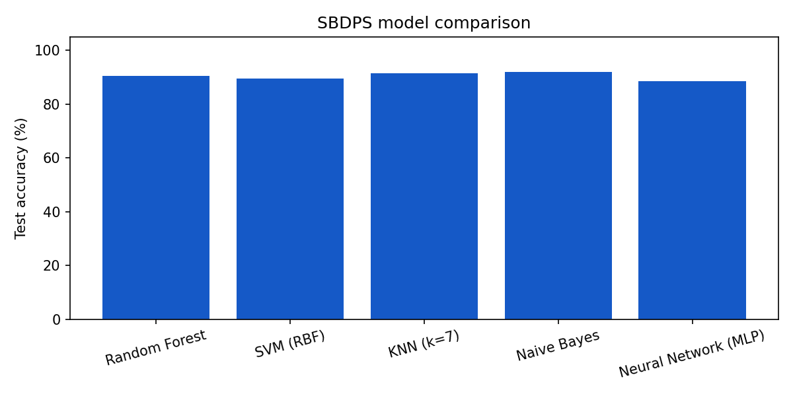

# SBDPS: Symptom-Based Disease Prediction System

A voice-enabled early-screening web application. The user speaks or types symptoms in **English, Hinglish or Hindi**
(or picks them from a list), and the system returns the **top 3 possible conditions** with a confidence score, an
**urgency level** (self-care / visit a clinic / emergency) and Indian helpline links.
Built as a major project, based on the IEEE-format paper *SBDPS*.

> **Disclaimer:** SBDPS is an educational screening aid, not a medical diagnosis tool. Always consult a qualified doctor.

## Features
- 40 diseases and 57 symptoms (infectious, digestive, respiratory, metabolic, neurological, musculoskeletal, cardiovascular)
- **Voice assistant:** speech-to-text input (Web Speech API, `en-IN` / `hi-IN`), spoken results (speech synthesis),
  voice commands ("clear", "read aloud")
- Hinglish NLP: maps phrases such as *"mujhe bukhar hai aur sir dard"* to symptoms, with negation handling ("bukhar nahi hai")
- Five trained ML models compared; Random Forest served through a Flask REST API
- Red-flag safety rule: a high-urgency condition that matches 2+ symptoms is never hidden from the top 3
- Offline fallback: if the backend is unreachable, the frontend uses an in-browser scoring engine
- Dark mode, recent-check history (stored only in the browser), copy-summary, 108 / 14555 / e-Sanjeevani shortcuts

## Project structure
```
SBDPS/
├── backend/
│   ├── app.py              Flask app (REST API + serves the frontend)
│   ├── predictor.py        Loads models, ranks diseases, urgency + safety rules
│   ├── nlp.py              English / Hinglish / Hindi symptom extraction
│   ├── train_models.py     Trains and compares the 5 classifiers
│   └── config.py           Paths and constants
├── dataset/
│   ├── generate_dataset.py Builds symptom_dataset.csv from the knowledge base
│   ├── symptom_dataset.csv 6,000 rows x 57 symptom columns + prognosis
│   ├── symptoms.json       Symptom codes, English + Hinglish names, aliases
│   └── diseases.json       Disease, category, urgency, key symptoms, description
├── models/
│   ├── *.joblib            Trained models
│   ├── metrics.json        Accuracy / precision / recall / F1 / cross-validation
│   └── model_comparison.png
├── frontend/
│   ├── index.html
│   ├── css/style.css
│   └── js/                 app.js (voice + UI + API client), data.js (offline knowledge base)
├── tests/                  18 pytest tests (NLP, predictor, API)
├── requirements.txt
└── README.md
```

## Setup (Windows, VS Code terminal)
```bash
python -m venv venv
venv\Scripts\activate            # macOS/Linux: source venv/bin/activate
pip install -r requirements.txt

python -m dataset.generate_dataset   # optional: regenerate the dataset
python -m backend.train_models       # optional: retrain and re-evaluate the models
python -m pytest -q                  # run the tests
python -m backend.app                # start the server
```
Open **http://localhost:5000** in Chrome or Edge. The microphone works on `localhost`; the page shows
"Engine: Random Forest · Flask API" when the backend is connected.

## REST API
| Method | Endpoint | Purpose |
|---|---|---|
| GET | `/api/health` | Status and active model |
| GET | `/api/symptoms` | Symptom list (code, English, Hinglish) |
| GET | `/api/diseases` | Disease knowledge base |
| GET | `/api/models` | Benchmark metrics of all models |
| POST | `/api/extract` | `{"text": "..."}` returns detected symptom codes |
| POST | `/api/predict` | `{"symptoms": ["fv","hd"], "text": "...", "model": "random_forest"}` returns top 3 predictions |

## Model results
Held-out test set: 1200 rows (20%), trained on 4800. Macro-averaged metrics; 5-fold cross-validation accuracy.

| Model | Accuracy | Precision | Recall | F1 | CV accuracy |
|---|---|---|---|---|---|
| Random Forest | 90.4% | 90.5% | 90.4% | 90.3% | 91.3% ± 0.4 |
| SVM (RBF) | 89.4% | 89.5% | 89.4% | 89.3% | 91.4% ± 0.5 |
| KNN (k=7) | 91.5% | 91.6% | 91.5% | 91.5% | 91.7% ± 0.4 |
| Naive Bayes | 92.0% | 92.2% | 92.0% | 91.9% | 93.3% ± 0.8 |
| Neural Network (MLP) | 88.5% | 88.5% | 88.5% | 88.4% | 89.5% ± 0.7 |



**Important notes for the report**
- The dataset is **synthetic**: it is generated from a curated symptom-disease knowledge base (each disease's typical
  symptoms appear with fixed probabilities, plus random noise). The scores therefore measure how well the models learn
  that knowledge base. They are **not** clinical accuracy and will differ from the figures in the paper.
- Naive Bayes scores highest here because the generator treats symptoms as independent, which is the assumption
  Naive Bayes makes. Random Forest is served by default (`DEFAULT_MODEL` in `backend/config.py`) because its
  probabilities are less extreme and it supports feature-importance analysis. The CNN from the paper is replaced by a
  multi-layer perceptron (MLP) because the input is a flat binary vector.
- To use a **real dataset** (for example a public symptom-disease CSV), save it as `dataset/symptom_dataset.csv` with
  one 0/1 column per symptom (matching the `column` names in `symptoms.json`) and a `prognosis` column, then run
  `python -m backend.train_models`.

## Limitations and future work
- Not validated on real patient data; not a substitute for clinical judgement
- Add severity, duration, age and gender as inputs
- Calibrate probabilities, add explainability (SHAP) and more regional languages
- Deploy with HTTPS (Render / Railway) and add a user-feedback loop
